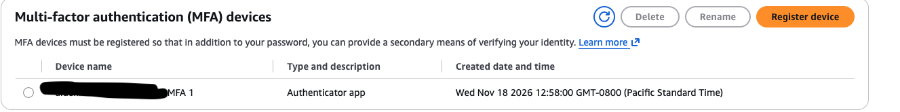
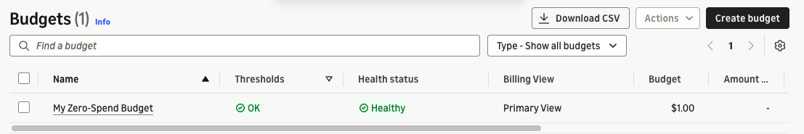

# Week one overview

### Shared Responsibility Model
The shared responsibility model was made to answer a question - when something goes wrong with security, whose fault is it? It depends on what part of the "program failed". Aws is in charge of security of the cloud, this is like the physical servers that run it. We are responsible for security in the cloud, which is everything we configure or upload.

### Root user
The root user is the account owner. It has unrestricted access to everything in the account. IAM policies can't limit it.

### IAM User
An IAM users are long-term identities for people or apps. Roles are the privileges that the root user assigns for them. Each IAM user has custom permissions in order to allow them to use the services hosted on AWS.

### How I sign in: IAM Identity Center
My account (intern02) is part of IDX Exchange's AWS Organization, so IDX controls the root user and I never sign in as root. Instead I sign in through IAM Identity Center with the InternAdmin role. I skipped creating an IAM admin user (Lab 1.3) because Identity Center gives me short-lived credentials that expire on their own, which is safer than permanent access keys that could leak. My MFA is registered on the Identity Center portal, and the CLI uses `aws configure sso` instead of access keys.

### Proof
- MFA registered on the access portal: 
- Zero-spend budget: 
