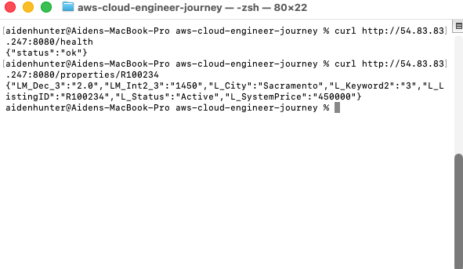
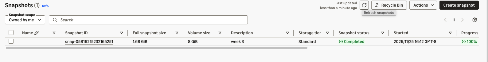

# Week 3 — Deploy PropertyLite to EC2

## 1. Launch the instance

### AMI and instance type
I launched an instance called property-api-01 using Amazon Linux 2023 as the AMI. An AMI is like a template for the server, it decides what operating system it starts with. I picked t2.micro as the instance type because it is free tier eligible and PropertyLite is a really small app, so it doesn't need much CPU or memory.

### Key pair
I created a new RSA key pair called "aiden training-key" and downloaded it as a .pem file. This file is the private key that lets me SSH into the instance. AWS only lets you download it once, so if I lose it there is no way to get it back and I would need a new key pair and a new instance.

I moved it from my Desktop to ~/.ssh/training-key.pem and ran `chmod 400` on it so only I can read it. If you skip this step SSH refuses to use the key because the permissions are "too open". The .pem never goes in my repo, my .gitignore blocks `*.pem` just in case.

### Security group
A security group is a firewall for the instance. It decides what traffic is allowed in. I made two inbound rules:
- SSH (port 22) from My IP only, so only my laptop can log into the server
- Custom TCP (port 8080) from anywhere (0.0.0.0/0), because that is the port PropertyLite runs on and I want to reach it from my browser/terminal

I didn't open HTTP (port 80) or HTTPS (port 443) because the app doesn't use them. AWS gave a warning about 0.0.0.0/0 but that is expected for 8080 since it's a public demo API with no sensitive data. It would not be okay for SSH.

### User data (bootstrap script)
User data is a script that runs automatically the first time the instance boots. My script updates the system, installs Python and Flask, writes app.py and the sample CSV into /opt/property-api, and then starts the app in the background on port 8080. This means I don't have to SSH in and set anything up by hand, the server sets itself up.

The script in the handbook had a placeholder where app.py was supposed to go, so I had to paste in the full app.py from my propertylite folder or else the server would boot with no app on it.

## 2. Connect with SSH
I connected with:
```bash
ssh -i ~/.ssh/training-key.pem ec2-user@<public-ip>
```
The first time it asked if I trust the host and I typed yes. This only happens once, my laptop saves the server's fingerprint so it can warn me if it ever changes.

Once I was in I watched the setup run with `sudo tail -f /var/log/cloud-init-output.log`. It showed Flask installing successfully. There were two warnings at the end (pip running as root and a cloud-init message) but both are harmless.

## 3. Test the app
After about 3 minutes I curled the app from my laptop:
```bash
curl http://<public-ip>:8080/health
curl http://<public-ip>:8080/properties/R100234
```
/health returned {"status":"ok"} and /properties/R100234 returned the Sacramento listing. This is the same app I ran locally in Week 0 but now it is running on a real server in AWS.



## 4. EBS snapshot (Lab 3.2)
EBS is the hard drive attached to the instance. A snapshot is a backup of that drive at a certain point in time. I went to EC2 → Volumes → selected the root volume → Actions → Create snapshot. It took about 3 minutes to go from pending to completed. The volume is 8 GiB but the snapshot was only 1.68 GiB because it only saves the space that is actually used.

If I created a new volume from this snapshot, I would get an exact copy of the drive from that moment, with Amazon Linux, Python, Flask, and PropertyLite already on it. I could attach it to a new instance and it would be the same server.



## 5. Cleanup
- Terminated property-api-01
- Checked the Volumes tab, the volume was already gone because root volumes are set to delete on termination by default
- Deleted the snapshot, since snapshots don't get deleted with the instance and they cost money every month
- Kept the key pair and .pem file because I will use them again in later weeks
